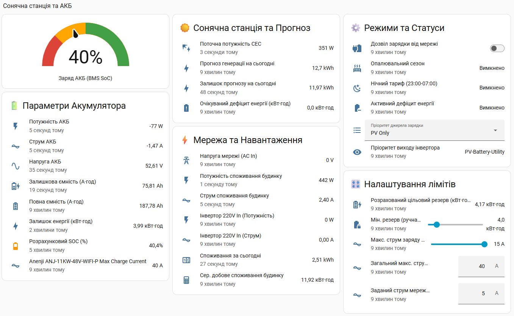

# Anenji Inverter & Solar Battery Management Package for Home Assistant




Комплексний пакет налаштувань (YAML Package) для **Home Assistant**, призначений для інтелектуального керування гібридним сонячним інвертором (Anenji / PowMr / Voltronic), акумуляторною батареєю (LiFePO4 з BMS) та зовнішнім DIN-реле введення мережі 220В.

Пакет оптимізує споживання в умовах графіків відключень, автоматично підраховує необхідний резерв енергії, захищає батарею від глибокого розряду та динамічно регулює струм заряду від сонячних панелей (СЕС) і міської мережі.

---
Приклад карток для Dashboard знаходиться у файлі [dashboard.yaml](dashboard.yaml)

## 📌 Основні можливості

* **Динамічний розрахунок цільового резерву (kWh):**
  * Автоматично розраховує добове середнє споживання будинку (`Exponential Moving Average`).
  * Враховує сезонність (опалювальний сезон: жовтень–квітень = 60% резерву; літо = 35% резерву).
  * Динамічно коригує дефіцит енергії з урахуванням залишку прогнозу генерації СЕС (Solcast).
* **Аварійний та автоматичний байпас мережі 220В:**
  * **SOC < 15%:** Автоматичне безпечне переключення живлення будинку на міську мережу (`PV-Utility-Battery`).
  * **SOC ≥ 25%:** Повернення живлення будинку на сонячні панелі та АКБ (`PV-Battery-Utility`).
  * **Захист від ложних спрацьовувань та дублювання:** Безпечні затримки 30 секунд між перемиканнями та перевірка поточного стану інвертора перед надсиланням сповіщень.
* **Адаптивний контроль струму заряду СЕС (06:00–21:00):**
  * Динамічно змінює струм заряджання АКБ залежно від відсотка SOC та залишку прогнозу сонячної генерації на день.
  * У нічний час (21:00–06:00) встановлює безпечний фіксований струм (30А).
* **Інтелектуальний нічний/денний заряд від мережі:**
  * Заряджає АКБ від мережі лише за наявності реального дефіциту та дозволу користувача.
  * Автоматично скасовує зарядку, якщо під час увімкнення DIN-реле в міській мережі відсутня напруга (Блекаут, U ≤ 180V).
* **Захист від ложних спрацьовувань при перезавантаженні HA:**
  * Вбудована перевірка стану системи через `sensor.online` (затримка 3 хвилини після ребуту).
* **Двостороннє сповіщення:**
  * Надсилання системних сповіщень (`persistent_notification`) про кожен реальний етап виконання та помилки зворотного зв'язку від інвертора.

---

## 🏗️ Архітектура та Логіка роботи

### 1. Розрахунок дефіциту та резерву

$$ \text{Target Reserve (kWh)} = \text{Clamp}(\text{Daily Average} \times \text{Seasonal Ratio}, \text{Min Reserve}, 0.85 \times \text{Full Capacity}) $$

$$ \text{Energy Deficit} = \text{Target Reserve} - (\text{Remaining Battery kWh} + \text{Remaining Solar Forecast}) $$

### 2. Безпечне переключення байпасу (Scripts)

* **Запит переключення на мережу:**
  1. Перевірка: якщо вихід вже на мережі і реле увімкнено — зупинка (без дублювання).
  2. Увімкнути DIN-реле (`switch.invertor_220_in`).
  3. Затримка 30 секунд *(стабілізація мережі)*.
  4. Зміна пріоритету виходу на `PV-Utility-Battery`.
  5. Затримка 30 секунд → Перевірка статусу → Сповіщення.

* **Запит повернення на АКБ/СЕС:**
  1. **Перевірка стану:** Якщо вихід інвертора вже перебуває в режимі `PV-Battery-Utility`, скрипт за потреби тихо вимикає DIN-реле (якщо воно залишалося увімкненим) і зупиняє виконання без надсилання зайвих сповіщень.
  2. Зміна пріоритету виходу на `PV-Battery-Utility`.
  3. Затримка 30 секунд.
  4. Вимкнення DIN-реле *(якщо не триває зарядка від мережі)*.
  5. Затримка 30 секунд → Перевірка статусу → Сповіщення про успішну зміну режиму.

---

## ⚙️ Перелік сутностей (Entity Mapping)

Для адаптації пакета під власний сетап замініть наступні `entity_id` у файлі на ваші власні:

| Категорія | ID сутності в пакеті | Опис |
| :--- | :--- | :--- |
| **Інвертор** | `select.anenji_anj_11kw_48v_wifi_p_output_source_priority` | Пріоритет джерела виходу |
| **Інвертор** | `select.anenji_anj_11kw_48v_wifi_p_charge_source_priority` | Пріоритет джерела заряду |
| **Інвертор** | `number.anenji_anj_11kw_48v_wifi_p_max_charge_current` | Максимальний загальний струм заряду |
| **Інвертор** | `number.anenji_anj_11kw_48v_wifi_p_max_ac_charge_current` | Максимальний струм заряду від мережі |
| **Інвертор** | `sensor.anenji_anj_11kw_48v_wifi_p_grid_voltage` | Напруга вхідної міської мережі |
| **Реле** | `switch.invertor_220_in` | Вхідне DIN-реле (вмикає подачу 220В на AC IN) |
| **BMS** | `sensor.bms_battery_state_of_charge` | Відсоток заряду батареї (SOC %) |
| **BMS** | `sensor.bms_battery_remaining_capacity` | Залишкова ємність АКБ (Ah) |
| **BMS** | `sensor.bms_battery_full_capacity` | Повна ємність АКБ (Ah) |
| **BMS** | `sensor.bms_battery_total_voltage` | Загальна напруга АКБ (V) |
| **Прогноз** | `sensor.volcast_solar_forecast_solar_forecast_remaining_today` | Залишок прогнозу генерації на сьогодні (kWh) |
| **Прогноз** | `sensor.volcast_solar_forecast_energy_forecast_tomorrow` | Прогноз генерації на завтра (kWh) |
| **Система** | `sensor.online` | Сенсор часу безперервної роботи / uptime системи |

---

## 📥 Встановлення та налаштування

### Крок 1: Увімкнення пакетів у Home Assistant
Переконайтеся, що у вашому файлі `configuration.yaml` активовано підтримку пакетів:

```yaml
homeassistant:
  packages: !include_dir_named packages
```

### Крок 2: Додавання файлу
1. Створіть директорію `/config/packages/`, якщо її ще немає.
2. Скопіюйте файл `solar_battery_management.yaml` у папку `/config/packages/`.

### Крок 3: Адаптація Entity ID
Відкрийте файл `solar_battery_management.yaml` у текстовому редакторі (наприклад, VS Code Add-on) та виконайте масову заміну (`Ctrl + H`) назв сутностей на ваші власні відповідно до таблиці вище.

### Крок 4: Перезавантаження
1. Перейдіть у **Налаштування** → **Інструменти розробника** → **YAML**.
2. Натисніть **Перевірити конфігурацію**.
3. Якщо перевірка успішна, натисніть **Перезавантажити конфігураційні файли пакетів** (або перезапустіть Home Assistant).

---

## 🎮 Керування через інтерфейс (Dashboard Helpers)

Після завантаження пакета в системі з'являться наступні елементи керування:

1. **`input_boolean.allow_grid_charge`** (*Дозвіл заряджання від мережі*) — головний тумблер. Якщо вимкнено, автоматична зарядка від мережі не розпочнеться за жодних умов (окрім критичного аварійного байпасу навантаження).
2. **`input_number.min_target_reserve_kwh`** (*Мінімальний резерв АКБ*) — нижня межа цільового резерву (за замовчуванням: 4.0 кВт·год).
3. **`input_number.max_ac_charge_current`** (*Струм зарядки від мережі*) — обмеження струму, який буде виставлятися інвертору при нічному/дефіцитному заряді від мережі (за замовчуванням: 15А).

---

## 🛡️ Безпека та Захист (Reboot Guard & Anti-Spam)

1. **Захист після перезапуску HA (Uptime Guard):**
   Щоб запобігти хибному перемиканню реле та надсиланню хаотичних сповіщень під час перезапуску Home Assistant, в автоматизацію `solar_battery_soc_bypass_logic` вбудовано перевірку стану системи:
   ```yaml
   condition:
     - condition: template
       value_template: >
         
         
           false
         
           {{ (now() - up | as_datetime).total_seconds() > 180 }}
         
   ```
   *Автоматизація блокується на 3 хвилини (180 секунд) після кожного ребуту HA, поки всі сутності Modbus та BMS не відновлять свої реальні значення.*

2. **Фільтрація дублюючих сповіщень (State Verification):**
   Усі скрипти перед зміною параметрів та відправкою сповіщень перевіряють поточний стан інвертора. Якщо бажаний стан уже досягнуто, скрипт завершує роботу без циклічного надсилання інформаційних повідомлень.

---

## 📄 Ліцензія

Цей проект поширюється під ліцензією [MIT](LICENSE). Ви можете вільно використовувати, змінювати та поширювати його у власних конфігураціях.