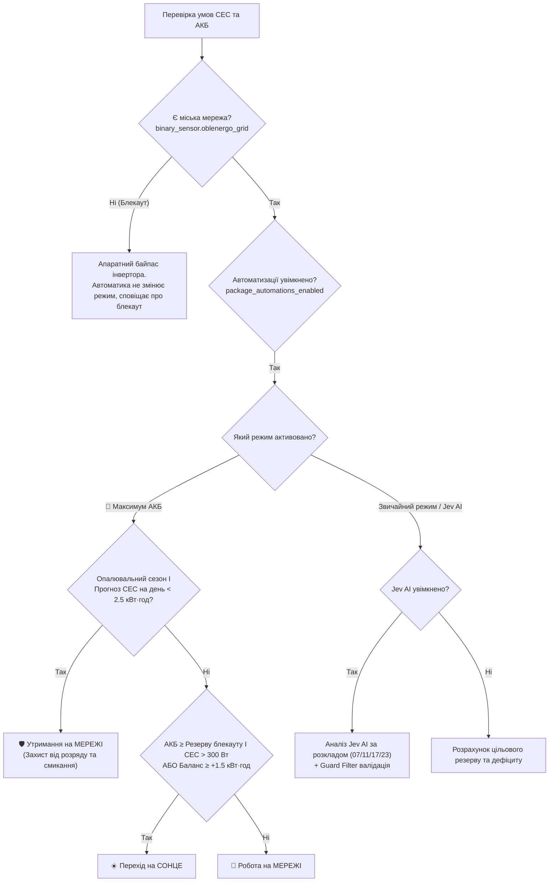

# Anenji Inverter & Solar Battery Management Package for Home Assistant (v2.0)


Комплексний пакет налаштувань (YAML Package) для **Home Assistant**, призначений для інтелектуального керування гібридним сонячним інвертором (підтримка *Anenji / PowMr / Voltronic*), акумуляторною батареєю (*LiFePO4 з Pace BMS / JSD*) та зовнішнім DIN-реле введення мережі 220В.

Пакет оптимізує споживання сонячної енергії в умовах графіків відключень світла та двозонних/сезонних тарифів, запобігає зайвому циклічному перемиканню («смиканню») інвертора між режимами Сонце/Мережа в похмурі дні та захищає акумулятор від деградації.

У системі реалізовано гібридний підхід:
1. **Детермінована локальна автоматика (YAML):** миттєво реагує на аварійні стани, падіння заряду АКБ та стрибки генерації.
2. **Інтелектуальне планування (Jev AI LLM):** за розкладом 4 рази на добу аналізує прогноз погоди, залишок ємності та історію навантаження через мовну модель.

---
Приклад карток для інтерфейсу Lovelace знаходиться у файлі [dashboard.yaml](dashboard.yaml).

---

## 📌 Основні можливості (Версія 2.0)

* **Суб-режим «🔋 Максимум АКБ» (`input_boolean.max_battery_mode`):**
  * Призначений для максимального збереження заряду батареї в холодну пору року та при загрозі блекаутів.
  * Прив'язаний до регульованого резерву `input_number.blackout_reserve_kwh`.
  * **Захист від зимового/похмурого «смикання»:** якщо активний опалювальний сезон (`binary_sensor.heating_season`) і добовий прогноз сонячної генерації менший за **2.5 кВт·год**, будинок безумовно утримується на міській мережі. Вся доступна сонячна генерація спрямовується виключно на заряд або буферизацію АКБ.
* **Інтеграція з моделлю штучного інтелекту Jev AI (`input_boolean.use_jev_ai`):**
  * Аналіз доцільності перемикання режимів за розкладом 4 рази на добу:
    * **07:00 (Ранок):** оцінка ранкового піка та денного прогнозу сонця.
    * **11:00 (Обід):** оцінка пікової сонячної генерації.
    * **17:00 (Вечір):** підготовка до заходу сонця та збереження заряду на ніч.
    * **23:00 (Ніч):** оптимізація під нічний тариф.
  * **Фільтр безпеки (Guard Filter):** усі рекомендації моделі валідуються жорсткими правилами; у разі небезпеки або збою моделі автоматично спрацьовують надійні детерміновані фолбеки.
* **Режим «Блекаут / Економія» (`input_boolean.blackout_saving_mode`):**
  * Автоматичне перемикання живлення на мережу при досягненні резерву `input_number.blackout_reserve_kwh` для гарантованого збереження енергії на час відключень.
* **Суворий контроль заряду від мережі:**
  * Заряд батареї від міської мережі за замовчуванням заборонений. Заряджання можливе виключно за ручної активації `input_boolean.allow_grid_charge` або в аварійному режимі.
* **Обробка аварійних відключень Обленерго (`solar_grid_outage_handler`):**
  * Фіксує зникнення мережі (`binary_sensor.oblenergo_grid off`), надсилає сповіщення і не перемикає вихідні пріоритети під час блекауту (роботу повністю забезпечує апаратний байпас інвертора).
* **Автоматичний контроль DIN-реле (`switch.invertor_220_in`):**
  * Автоматика пакета ніколи не вимикає реле введення, а лише вмикає його за потреби (захист інвертора від роботи без мережі).
* **Адаптивне регулювання струму заряду СЕС:**
  * Динамічно регулює зарядний струм інвертора (від 10А до 50А) залежно від рівня SOC та залишку сонячного прогнозу.

---

## 🏗️ Схема прийняття рішень



---

## ⚙️ Перелік сутностей (Entity Mapping)

### Допоміжні перемикачі (`input_boolean`)

| Entity ID | Назва | Опис |
| :--- | :--- | :--- |
| `input_boolean.package_automations_enabled` | Головний вимикач пакета | Увімкнення/вимкнення всієї автоматики пакета |
| `input_boolean.max_battery_mode` | Режим «Максимум АКБ» | Суб-режим максимального збереження заряду АКБ |
| `input_boolean.use_jev_ai` | Використовувати Jev AI | Дозвіл ШІ приймати рішення щодо пріоритетів виходу |
| `input_boolean.blackout_saving_mode` | Режим Блекаут/Економія | Утримання підвищеного резерву на випадок відключень |
| `input_boolean.max_solar_battery_mode` | Режим Максимум Сонце/АКБ | Пріоритет максимального використання сонячної генерації |
| `input_boolean.allow_grid_charge` | Дозвіл заряду від мережі | Головний дозвіл на заряд АКБ від 220В |
| `input_boolean.auto_control_din_relay` | Автоконтроль DIN-реле | Дозвіл автоматиці керувати реле `switch.invertor_220_in` |
| `input_boolean.auto_day_night` | Авто перехід День/Ніч | Автоматичне перемикання за розкладом світанку/заходу |
| `input_boolean.output_on_grid` | Вихід на мережі | Ручний форсований перехід на мережу |

### Числові параметри (`input_number`)

| Entity ID | Опис | Діапазон |
| :--- | :--- | :---: |
| `input_number.min_target_reserve_kwh` | Мінімальний цільовий резерв АКБ у звичайному режимі | 0.5 – 15.0 кВт·год |
| `input_number.blackout_reserve_kwh` | Резерв АКБ у режимах Блекаут та «Максимум АКБ» | 1.0 – 15.0 кВт·год |
| `input_number.bad_weather_solar_threshold_kwh` | Поріг поганої погоди для утримання резерву | 1.0 – 10.0 кВт·год |
| `input_number.max_ac_charge_current` | Максимальний струм заряду від мережі | 2 – 40 А |
| `input_number.solar_forecast_calibration_factor` | Коефіцієнт калібрування прогнозу генерації СЕС | 0.5 – 1.5 |
| `input_number.daily_energy_avg_kwh` | Добове середнє споживання будинку | 1.0 – 30.0 кВт·год |
| `input_number.evening_switch_deficit_threshold_kwh` | Поріг вечірнього дефіциту для повернення на мережу | 0.1 – 5.0 кВт·год |
| `input_number.significant_deficit_threshold_kwh` | Поріг значного дефіциту сонячної енергії | 0.5 – 10.0 кВт·год |
| `input_number.solar_charge_current_*` | Пороги та рівні струму заряду СЕС (High, Mid, Low, Night) | 10 – 50 А |

### Текстові статуси (`input_text`)

| Entity ID | Опис |
| :--- | :--- |
| `input_text.output_mode_reason` | Текстове пояснення причини останнього перемикання виходу |
| `input_text.jev_last_decision` | Останній висновок та рекомендація моделі Jev AI |

### Зовнішні сенсори системи

| Entity ID | Призначення |
| :--- | :--- |
| `select.anenji_anj_11kw_48v_wifi_p_output_source_priority` | Вибір режиму інвертора (`Solar-Utility-Battery` / `Utility-Solar-Battery`) |
| `sensor.bms_battery_state_of_charge` | Відсоток заряду АКБ (SOC %) |
| `sensor.bms_battery_remaining_kwh` | Залишок енергії в АКБ (кВт·год) |
| `sensor.pv_total_power_corrected` | Миттєва потужність СЕС (Вт) |
| `sensor.volcast_solar_forecast_energy_forecast_today` | Прогноз генерації Solcast на поточний день (кВт·год) |
| `binary_sensor.oblenergo_grid` | Наявність напруги міської електромережі |
| `binary_sensor.heating_season` | Опалювальний сезон (впливає на тариф і поріг 2.5 кВт·год) |
| `switch.invertor_220_in` | DIN-реле входу 220В інвертора |

---

## 📥 Встановлення та налаштування

1. **Увімкнення пакетів:** переконайтеся, що у вашому `configuration.yaml` підключено директорію пакетів:
   ```yaml
   homeassistant:
     packages: !include_dir_named packages
   ```
2. **Копіювання файлу:** помістіть файл `solar_battery_management.yaml` у папку `packages/` вашого Home Assistant.
3. **Адаптація сутностей:** якщо назви ваших сенсорів інвертора або BMS відрізняються, здійсніть масову заміну відповідних Entity ID у файлі пакета.
4. **Дашборд:** скопіюйте секцію з файлу `dashboard.yaml` у ваш дашборд Lovelace для отримання панелі керування та вбудованої документації.
5. **Перезавантаження:** перевірте конфігурацію Home Assistant та виконайте швидке перезавантаження (або оновіть пакети автоматизацій).

---

## 🛡️ Безпека та надійність

* **Захист від ребутів:** після перезапуску HA автоматика очікує стабілізації сенсорів перед увімкненням перевірок.
* **Захист від залипання та брязкоту:** вбудовані затримки перемикань та гістерезис (-0.2 кВт·год / -2% SOC) запобігають частим перемиканням контактів інвертора.
* **Guard фільтри Jev AI:** рекомендації моделі проходять строгу перевірку перед передачею команд інвертору.

---

## 📄 Ліцензія

Розповсюджується за ліцензією [MIT](LICENSE). Вільне використання, адаптація та модифікація для некомерційних та комерційних цілей.
